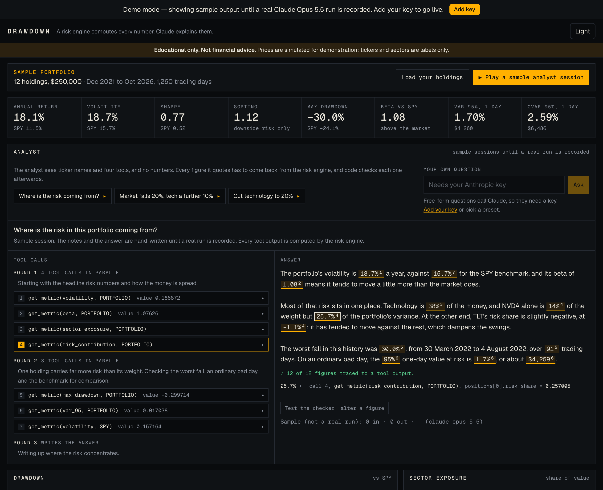
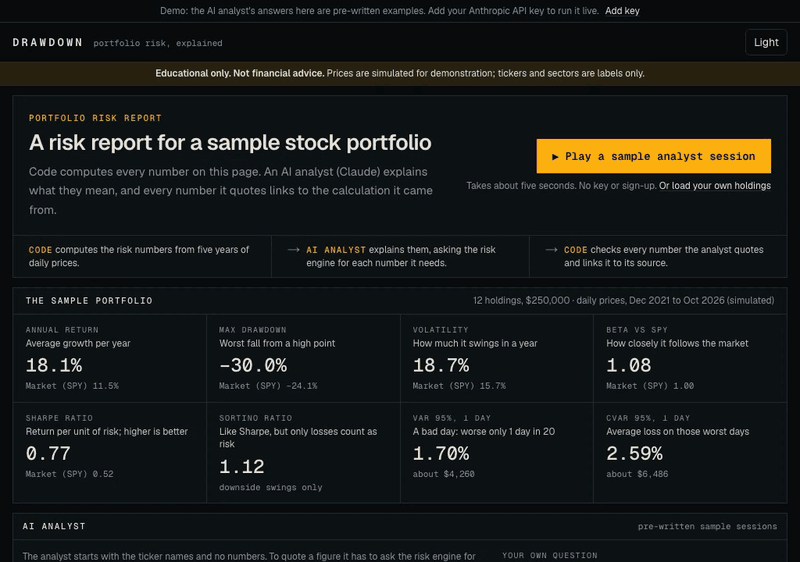
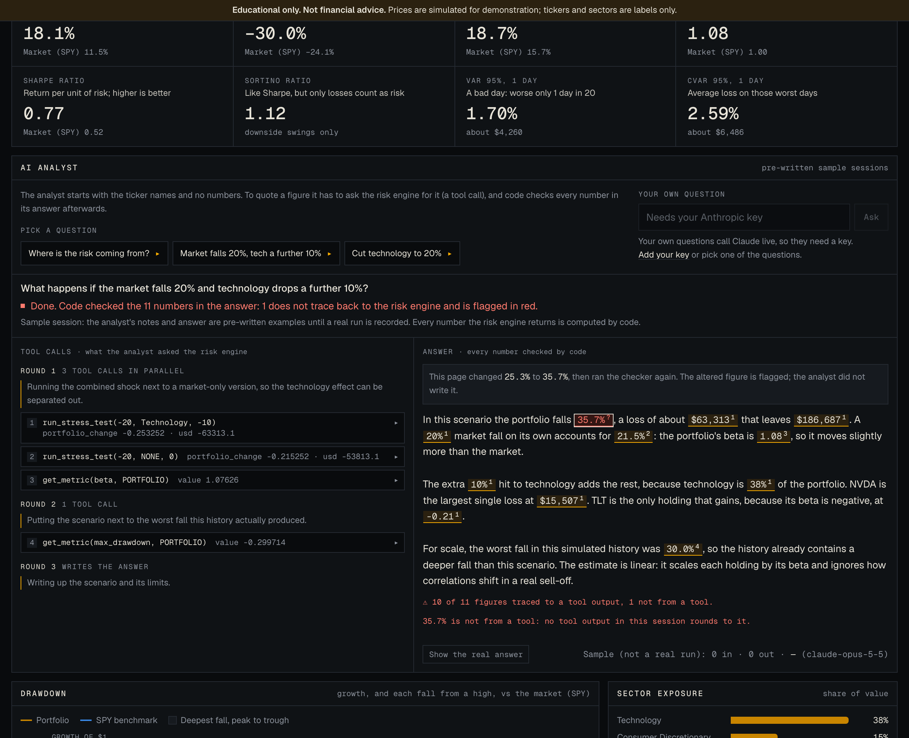
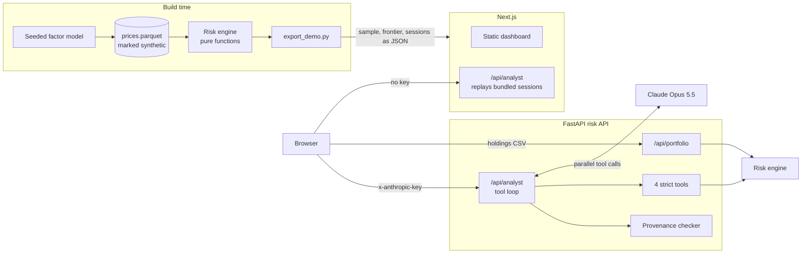
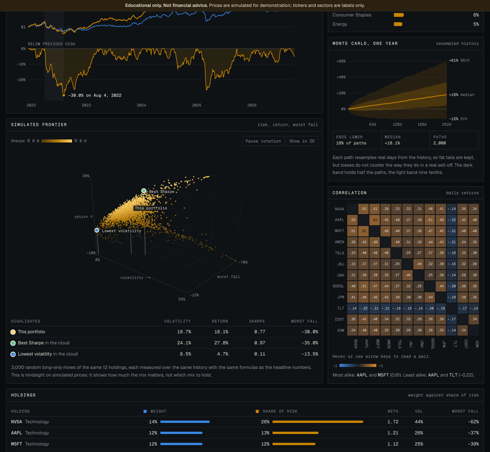
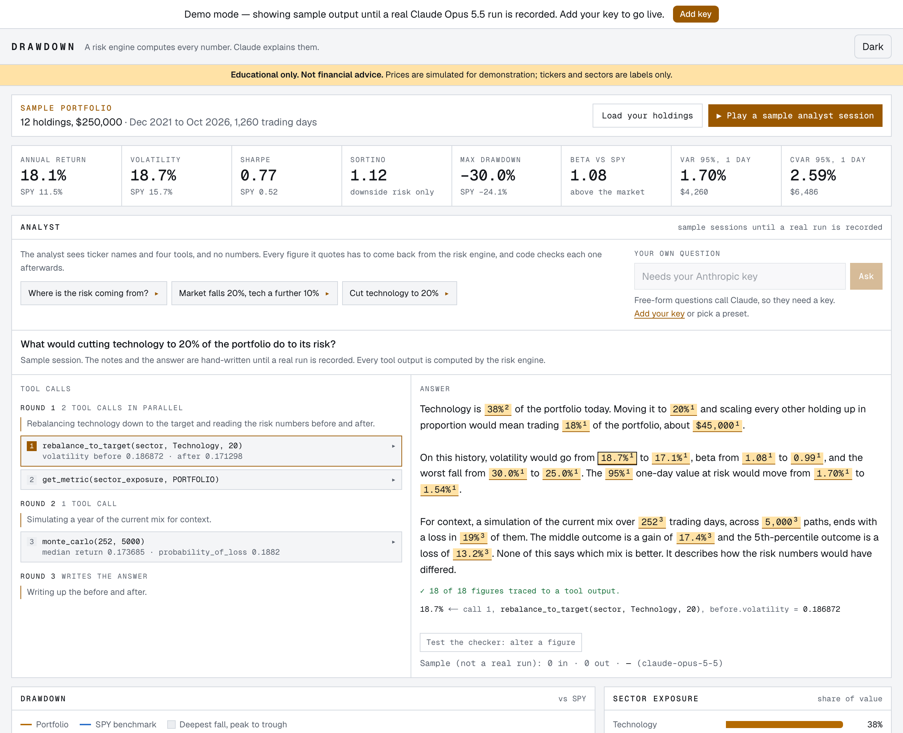
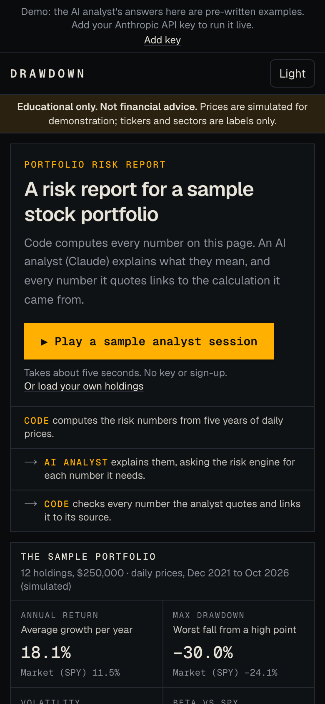

# Drawdown

> A portfolio risk X-ray. A deterministic risk engine computes every number; Claude Opus 5.5 explains them and runs what-if stress tests through tools, and code checks every figure it quotes against the tool outputs.

[](https://github.com/davezagin-max/drawdown/actions/workflows/ci.yml)
[](LICENSE)
[](https://drawdown.vercel.app)



**Educational only. Not financial advice.** Prices in this repository are simulated; ticker symbols and sectors are labels.

## Try it in 10 seconds

**[Open the live demo](https://drawdown.vercel.app)**: no key, no sign-up. Click **Play a sample analyst session** and watch the tool calls arrive, several at a time. Click any highlighted figure in the answer to see the exact tool output it was taken from. Then press **Test the checker: alter a figure**: the page changes one number and the checker flags it.

Demo data in this commit is hand-written sample output; `pnpm record` replaces it with real Claude Opus 5.5 runs. To be exact about what is hand-written: the analyst's progress notes and its answers. Every number on the page, including every tool output inside those sessions, is computed by the risk engine, and the app labels the sessions as samples until real runs are recorded.

Add your own Anthropic key in the app to ask the analyst your own questions. Live runs and your own holdings go to the Python risk API, so they need it running (see [Run locally](#run-locally)).



## Why it's interesting

- **The model never sees a number it did not ask a tool for.** The prompt contains ticker names and sectors, with no weights, values, or metrics. Four strict tools (`get_metric`, `run_stress_test`, `rebalance_to_target`, `monte_carlo`) are the only way to a figure, so the analyst's arithmetic is the engine's arithmetic. Tool outputs carry differences and totals precomputed, so the model has no reason to do sums.
- **Provenance is verified by code, not trusted.** After the answer, a deterministic checker ([`server/app/provenance.py`](server/app/provenance.py)) finds every number in the text and looks for a tool output it is a faithful rounding of. It handles percent against fraction (`18.7%` for `0.186872`), dollars, `$63k`, negatives written as words, and it skips dates, years, ordinals, and names like "S&P 500". When two outputs round to the same figure it picks by exactness, then by the words in the sentence, and tells you how many others would have matched. An unmatched figure is shown in red as "not from a tool". Each session also ships a self-test: one figure altered, with the checker's verdict on the altered text.
- **Every risk metric is a pure function tested against arithmetic done by hand.** [`server/tests/test_risk.py`](server/tests/test_risk.py) states the working in comments: the squared deviations, the sample variance, the percentile position. Conventions (252-day year, sample standard deviation, a 4% risk-free rate, VaR as a positive loss) are written once at the top of [`server/app/risk.py`](server/app/risk.py).



## Architecture



The deployed site works with the Python API switched off. A Python export script precomputes the sample portfolio's analysis, the frontier cloud, and the analyst sessions; the Next.js app bundles that JSON and replays sessions from its own route. Both servers write the same server-sent-event frames, so the browser reads either with one function. Only uploaded holdings and live analyst runs reach FastAPI.



## How it uses Claude Opus 5.5

| Feature                                            | Why                                                                                                                                                                                                                                                      |
| -------------------------------------------------- | -------------------------------------------------------------------------------------------------------------------------------------------------------------------------------------------------------------------------------------------------------- |
| Agentic tool loop (`call_claude` with `handlers`)  | The model chooses which metrics and what-ifs it needs; the engine executes them. Six rounds at most, then a clear error.                                                                                                                                 |
| Parallel tool calls                                | The prompt asks for independent lookups in one turn. Handlers run concurrently and every result goes back in a single user message. The UI groups calls by round.                                                                                        |
| Strict tool schemas                                | `strict: true` with enums for metric, subject (all 52 tickers), and sector, so inputs always parse. Limits a strict schema cannot express (shock size, horizon, simulation count) are enforced in the handler and returned to the model as a tool error. |
| Checking that tools were used                      | Tool use cannot be forced, so the code checks. An answer with no tool call is thrown away and asked for once more with a mid-conversation system note. If the model still uses none, every figure is flagged.                                            |
| Adaptive thinking with explicit `effort: "medium"` | Thinking is always on; effort is the cost control. Progress notes between tool calls are requested with `thinking.display: "updates"` and streamed to the panel.                                                                                         |
| Prompt caching                                     | The tool definitions and system prompt are resent on every round of the loop, so they are marked cacheable.                                                                                                                                              |
| Refusals as results                                | `stop_reason: "refusal"` is returned, shown as a plain message, and its cost is still reported.                                                                                                                                                          |
| Untrusted input                                    | The visitor's question and holdings list are wrapped in tags the system prompt declares to be data. Tickers are validated against the bundled universe before they reach a prompt.                                                                       |

**Your key stays yours.** The app is bring-your-own-key. The key lives in your browser tab's memory (optionally `sessionStorage`), travels in an `x-anthropic-key` header to the risk API, and is used for that one request. The server never stores or logs it. Each live run shows its token count and cost. If you press Stop or close the tab, the API notices within a quarter of a second and makes no further model calls.

## Run locally

```bash
pnpm install
pnpm dev        # http://localhost:3300 in demo mode; nothing else is needed
pnpm dev:api    # optional, second terminal: the risk engine on :8300 (needs uv)
```

With the API running you can load your own holdings CSV, and with a key in the UI you can run the analyst live. `pnpm export` regenerates the bundled JSON after an engine change; `pnpm record` (with `ANTHROPIC_API_KEY` set) replaces the sample sessions with recorded runs.

To deploy: the Next.js app goes to Vercel as it is (`server/` is ignored there). The API runs anywhere Python does; set `ALLOWED_ORIGINS` on it to the site's origin and `NEXT_PUBLIC_API_URL` on the site to the API's address. Without that variable the site says live features are unavailable instead of failing.

| Light theme                    | Phone                                              |
| ------------------------------ | -------------------------------------------------- |
|  |  |

## Tests & quality

```bash
pnpm check                                  # lint, typecheck, 79 unit tests, production build
cd server && uv run pytest -q               # 191 tests
cd server && uv run ruff check . && uv run ruff format --check . && uv run mypy
```

What the tests cover:

- **Risk engine:** every metric against a hand-worked value, plus edge cases (a series that never falls, a market that never moves, a tie at the VaR threshold). Monte Carlo is checked against an independent replay of the same seeded draws.
- **Provenance checker:** 54 cases across rounding limits, percent against fraction, basis points, negatives, currency and scale words, dates and years that are not metrics, identifiers, zero, restated question figures, and choosing between sources that round to the same number.
- **Tools:** each handler on a four-day price history small enough to check by hand, and the schema limits the API enforces (no `minimum`, no `$ref`, all properties required).
- **Analyst loop, with a fake client:** request shape, parallel tool results in one message, the no-tools retry, refusal, truncation, round limit, and that a visitor who leaves stops the model calls.
- **Fixtures:** every stored tool call is re-run through the engine and every stored answer through the checker, in Python; every provenance chip is followed back to its tool output, in TypeScript. Assertions compare against each fixture's own `placeholder` flag, so they hold after real runs are recorded.
- **Smoke test:** a preset session replayed end to end through the real route handler with no key.

CI runs the same checks plus a gitleaks secret scan on every push.

## Tradeoffs, limitations, next steps

- **Prices are simulated.** Free market-data sources generally forbid redistribution, so real prices cannot be committed. A seeded factor model (market, sector, and idiosyncratic factors with fat tails, a slow bear market, and a crash) produces 1,260 days for 52 tickers with realistic betas and correlations. `server/scripts/fetch_prices.py` can load real prices into a gitignored folder for personal use; it was written offline, so its default endpoint and that provider's terms are unverified.
- **The live path has never called the real API.** No key was available while this was built. The loop is exercised by tests with a fake client and by a scripted stand-in behind the real endpoints in a browser, and the three demo sessions are hand-written samples. Recording real sessions is the first next step.
- **The checker proves presence, not truth.** It shows that a figure exists in a tool output at the precision quoted. It cannot tell whether the sentence around the figure is right, and a vague figure such as "1" is weak evidence because many values round to it.
- **The stress test is linear.** Each holding moves by its beta times the market shock, plus a sector shock. Real sell-offs change correlations; this does not.
- **Monte Carlo resamples single days.** That keeps fat tails but treats days as independent, so it understates how losses cluster. A block bootstrap would be the next refinement.
- **The frontier is a random cloud, not an optimiser.** "Best Sharpe" means best among 3,000 sampled mixes, in hindsight. It shows how much the mix matters and deliberately stops short of suggesting one.
- **Weights are held fixed** (rebalanced daily), with no costs or taxes, and the risk-free rate is a constant 4%.
- **Cancellation is cooperative.** A model call already in flight finishes; the next one is never made.
- **The checker lives in Python only.** The browser renders its verdict and never re-derives it, so a live session needs the API.
- Rate limiting is in memory per server instance: enough to blunt abuse of a demo, not a global quota.

---

Built with Claude Code and Claude Opus 5.5.
